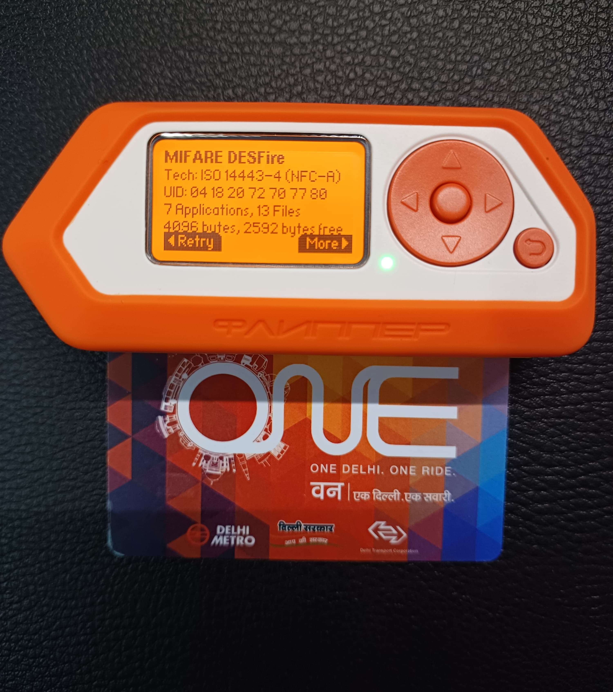
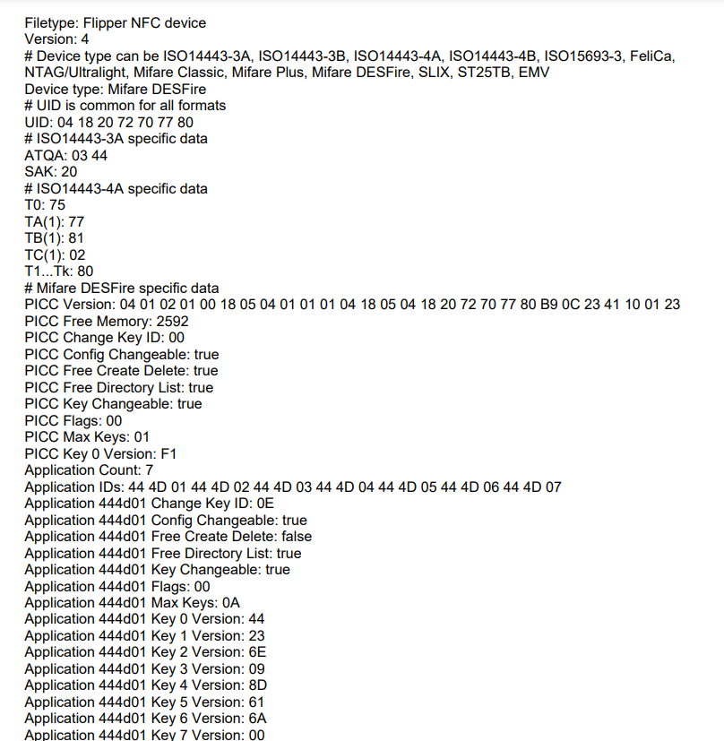
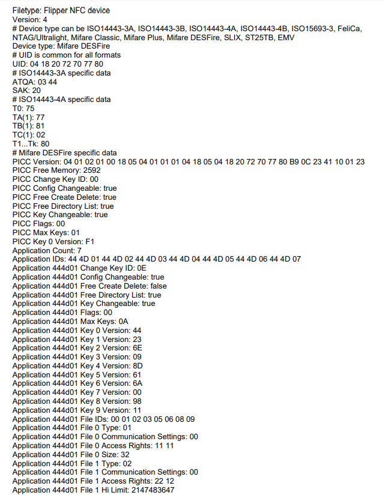

# 🚇 Delhi Metro NFC Card — MIFARE DESFire Analysis with Flipper Zero

> A technical teardown of a Delhi Metro **"ONE"** smart card (MIFARE DESFire, ISO/IEC 14443-4 Type A) using the **Flipper Zero**. This repository documents the card's identification attributes, memory layout, multi-application architecture, file system, access-control model, and cryptographic key configuration — strictly as a passive, read-only security-research exercise.

<p align="left">
  
  
  
  
  
  
</p>

---

## 📑 Table of Contents

- [Overview](#-overview)
- [Objective](#-objective)
- [Hardware & Standards](#-hardware--standards)
- [Card at a Glance](#-card-at-a-glance)
- [Key Findings](#-key-findings)
- [Card Architecture](#-card-architecture)
- [Methodology](#-methodology)
- [Repository Structure](#-repository-structure)
- [How to Reproduce](#-how-to-reproduce)
- [Documentation](#-documentation)
- [Responsible Disclosure & Ethics](#-responsible-disclosure--ethics)
- [References](#-references)
- [License](#-license)

---

## 🔍 Overview

Contactless transit cards are among the most widely deployed secure elements in everyday use. The Delhi Metro Rail Corporation (DMRC) "ONE" card is built on NXP's **MIFARE DESFire** platform — a family of ISO/IEC 14443-4 compliant smart cards designed for secure, multi-application deployments in public transport and access control.

This project uses a **Flipper Zero** to perform a non-invasive, read-only analysis of the card's publicly readable metadata: its unique identifier, protocol-level attributes, PICC (Proximity Integrated Circuit Card) configuration, application directory, file system, and cryptographic key *versions*. The goal is to understand **how a production transit card is architected** — not to defeat its security, extract secret keys, or manipulate value.

> ⚠️ **No cryptographic keys were recovered and no value/balance data was modified.** All information in this repository is limited to structural metadata that the card exposes to any ISO 14443-4 reader. See [Responsible Disclosure & Ethics](#-responsible-disclosure--ethics).

---

## 🎯 Objective

To analyze the **data structure, security features, and configuration** of a Delhi Metro MIFARE DESFire smart card using NFC technology and the Flipper Zero, and to document:

1. Card identification and ISO 14443 protocol attributes.
2. PICC-level memory and configuration flags.
3. The multi-application directory and per-application settings.
4. The file system (file types, sizes, access rights, communication modes).
5. The cryptographic key configuration (key counts and versions) per application.

----
## 🪪 Card at a Glance

<p align="center">
  
</p>

| Attribute        | Value                           |
| ---------------- | ------------------------------- |
| **Device Type**  | MIFARE DESFire                  |
| **Technology**   | ISO 14443-4 (NFC-A)             |
| **UID**          | `04 18 20 72 70 77 80` (7-byte) |
| **ATQA**         | `03 44`                         |
| **SAK**          | `20`                            |
| **Total EEPROM** | 4096 bytes                      |
| **Free Memory**  | 2592 bytes                      |
| **Applications** | 7                               |
| **Files**        | 13 (across all applications)    |
|                  |                                 |

---

## 🧰 Hardware & Standards

| Component | Details |
|-----------|---------|
| **Research Tool** | Flipper Zero (RFID/NFC multi-tool, 13.56 MHz HF reader) |
| **Target Card** | Delhi Metro "ONE" card — *One Delhi. One Ride.* |
| **Chip Family** | NXP MIFARE DESFire |
| **Protocol** | ISO/IEC 14443 Type A, Parts 3 & 4 (ISO14443-3A / ISO14443-4A) |
| **Operating Frequency** | 13.56 MHz |
| **Dump Format** | Flipper NFC device file (`.nfc`, Version 4) |

---

## 🧩 Key Findings

- **Multi-application layout** — The card hosts **7 applications** with sequential IDs `444D01` → `444D07`. The ASCII of `44 4D` is **"DM"** (Delhi Metro), a strong hint that the AID namespace is vendor-branded.
- **Tiered security per application** — Application `444D01` is the most feature-rich: it declares up to **10 cryptographic keys** (`Max Keys: 0A`) and **8 files** of varying types, while `444D02`–`444D07` are lighter (5 keys each), consistent with a primary "wallet/ticketing" app plus auxiliary apps.
- **Value files for fare handling** — `444D01` contains **value files** (type `02`) with credit limits (`Hi Limit: 2147483647`), the classic DESFire primitive for storing a monetary balance with bounded credit/debit operations.
- **Record & backup files** — The app also uses a **linear/cyclic record file** (type `04`, with `Max`/`Cur` record counters) and **backup data files** (type `00`) — typical for transaction logs and atomic, power-loss-safe writes.
- **Granular access-control** — Each file carries 2-byte **access rights** (e.g. `11 11`, `22 12`, `33 13`) encoding separate Read / Write / Read&Write / Change keys, demonstrating fine-grained, key-referenced permissions.
- **Key diversity** — Non-zero key versions (`44`, `23`, `6E`, `09`, `8D`, `61`, `6A`, `98`, `11`, …) on `444D01` indicate real, provisioned keys; auxiliary apps show `00` versions, suggesting reserved or unprovisioned slots.
- **Configurable PICC** — At card level: `Config Changeable: true`, `Key Changeable: true`, `Free Directory List: true` — the directory is enumerable, which is exactly why structural analysis is possible without any secret.

> See [`docs/04-findings.md`](docs/04-findings.md) for the full annotated breakdown.

---

## 🏗 Card Architecture

```
PICC (MIFARE DESFire) ── UID 04 18 20 72 70 77 80
│  4096 B total · 2592 B free · Max Keys 01 · Key 0 ver F1
│  Config Changeable ✓   Free Create/Delete ✓   Free Dir List ✓
│
├── App 444D01  "DM01"  ── Max Keys 0A (10) · 8 files
│     ├── File 00  Standard Data   AR 11 11   32 B
│     ├── File 01  Value           AR 22 12   Hi 2147483647
│     ├── File 02  Value           AR 33 13   Hi 2147483647 · Credit 450
│     ├── File 03  Record          AR 44 14   32 B · Max 11 / Cur 10
│     ├── File 05  Standard Data   AR 55 15   32 B
│     ├── File 06  Standard Data   AR 66 16   32 B
│     ├── File 08  Backup Data     AR 88 18   32 B
│     └── File 09  Backup Data     AR 99 19   32 B
│
├── App 444D02  "DM02"  ── Max Keys 05 · 5 files (Standard/Backup, AR 11 21)
├── App 444D03  "DM03"  ── Max Keys 05 · keys reserved (ver 00)
├── App 444D04  "DM04"  ── Max Keys 05 · keys reserved (ver 00)
├── App 444D05  "DM05"  ── Max Keys 05 · keys reserved (ver 00)
├── App 444D06  "DM06"  ── Max Keys 05 · keys reserved (ver 00)
└── App 444D07  "DM07"  ── Max Keys 05 · keys reserved (ver 00)
```

A detailed, field-by-field walkthrough lives in [`docs/05-card-architecture.md`](docs/05-card-architecture.md).

---

## 🧪 Methodology

1. **Read** — Place the card on the Flipper Zero HF antenna and run *NFC → Read*. The Flipper detects the card, negotiates the ISO 14443-4 protocol, and enumerates the DESFire directory.
2. **Capture** — Save the parsed output as a `.nfc` device file (Version 4) — see [`data/Delhi_metro.nfc`](data/Delhi_metro.nfc).
3. **Decode** — Interpret PICC attributes, AIDs, file descriptors, access-right nibbles, communication-setting bytes, and key-version bytes against the MIFARE DESFire specification.
4. **Document** — Translate raw hex into a structured, human-readable model (this repository).

Full methodology: [`docs/02-methodology.md`](docs/02-methodology.md).

### Flipper Zero output

| Live read | Parsed dump |
|-----------|-------------|
|  |  |

---

## 📂 Repository Structure

```
.
├── README.md                     ← you are here
├── LICENSE                       ← MIT
├── DISCLAIMER.md                 ← legal & ethical scope
├── CONTRIBUTING.md
├── CODE_OF_CONDUCT.md
├── .gitignore
├── data/
│   ├── Delhi_metro.nfc           ← raw Flipper NFC device file (v4)
│   └── raw/
│       └── Delhi_metro_nfc.pdf   ← original exported dump (PDF)
├── docs/
│   ├── 01-objective.md
│   ├── 02-methodology.md
│   ├── 03-technical-analysis.md
│   ├── 04-findings.md
│   ├── 05-card-architecture.md
│   └── references.md
└── assets/
    └── images/
        ├── flipper-card-read.jpg ← Flipper reading the ONE card
        ├── flipper-dump-01.png   ← on-tool dump, page 1
        └── flipper-dump-02.png   ← on-tool dump, page 2
```

---

## 🔁 How to Reproduce

> You need your **own** card and a Flipper Zero (or any ISO 14443-4 reader such as a PN532 + libfreefare / `nfc-list`). Only analyze cards you own.

**With Flipper Zero:**
```text
Menu → NFC → Read
  → hold your DESFire card against the HF antenna
  → wait for "Mifare DESFire" detection
  → More → save as .nfc
```

**With a PC + libnfc (cross-check UID / ATQA / SAK):**
```bash
# List any ISO 14443 card in the field
nfc-list

# DESFire-aware enumeration (reads public directory, no keys)
nfc-anticol        # low-level anticollision: UID, ATQA, SAK
```

The `.nfc` file in [`data/`](data/Delhi_metro.nfc) is a plain-text, version-4 Flipper device file and can be opened in any text editor.

---

## 📚 Documentation

| Document | Contents |
|----------|----------|
| [`docs/01-objective.md`](docs/01-objective.md) | Scope, goals, and research questions |
| [`docs/02-methodology.md`](docs/02-methodology.md) | Tooling, read workflow, decoding approach |
| [`docs/03-technical-analysis.md`](docs/03-technical-analysis.md) | PICC / application / file-level deep dive |
| [`docs/04-findings.md`](docs/04-findings.md) | Annotated findings and interpretation |
| [`docs/05-card-architecture.md`](docs/05-card-architecture.md) | Complete field-by-field card model |
| [`docs/references.md`](docs/references.md) | Specs, datasheets, and further reading |

---

## ⚖️ Responsible Disclosure & Ethics

This project is published **for educational and research purposes only**.

- ✅ The analysis is **passive and read-only**. Nothing was written to, cloned, emulated, recharged, or otherwise modified.
- ✅ Only **structural metadata** is documented — data the card exposes to any compliant reader. **No secret cryptographic keys were extracted or disclosed** (only *key version* bytes, which are public and reveal nothing about key material).
- ✅ The card analyzed is the **author's own, legally obtained** card.
- ❌ This repository does **not** contain, and will not be used to produce, methods for fare evasion, balance tampering, card cloning, or any unauthorized use of the Delhi Metro system.

Tampering with, cloning, or defrauding transit fare systems is illegal in most jurisdictions. Respect the law and the operators of the infrastructure you study. Full terms in [`DISCLAIMER.md`](DISCLAIMER.md).

---

## 🔗 References

- NXP — *MIFARE DESFire* product family overview
- ISO/IEC 14443 (Parts 1–4) — Contactless proximity cards
- Flipper Zero — NFC documentation

See [`docs/references.md`](docs/references.md) for the full list.

---

## 📄 License

Released under the [MIT License](LICENSE). Documentation and findings may be reused with attribution.

---

<sub>Built as part of ongoing NFC/RFID and embedded-security research. If you work with NFC or the Flipper Zero, contributions and corrections are welcome — see <a href="CONTRIBUTING.md">CONTRIBUTING.md</a>.</sub>
